# Manual de Usuario — Tienda Digital Nodo

> **Tienda Digital Nodo** es una aplicación de escritorio para gestionar una tienda de tecnología.  
> **Versión 1.0 · 25 de noviembre de 2026**  
> Julio Cesar Vidal Herazo · Juan Andrés Torres Peña · Camilo Andrés Palmera Fernández

---

---

## 1. Introducción

**Tienda Digital Nodo** es una aplicación de escritorio para una tienda de productos tecnológicos. Permite a los clientes explorar un catálogo, comprar productos y guardar favoritos, y a los administradores gestionar el inventario.

El sistema tiene dos perfiles:

| Perfil | Qué puede hacer |
|---|---|
| **Cliente** | Buscar y filtrar productos, ver detalles, agregar al carrito, finalizar compras, ver historial y lista de deseos. |
| **Administrador** | Ver el resumen del inventario, buscar productos por ID o nombre, editarlos, agregar unidades, registrar productos con imagen y eliminar productos. |

Módulos principales:

1. Acceso (login y registro).
2. Catálogo con búsqueda, filtros y orden.
3. Detalle de producto y productos relacionados.
4. Carrito de compras.
5. Historial de compras.
6. Lista de deseos.
7. Panel de administración.

### 1.1 Cómo leer esta guía

Cada apartado sigue el mismo formato: primero se explica **para qué sirve** la función, luego se indican **los pasos** y finalmente se muestra una **captura real del programa** con su pie de imagen. Así puedes seguir el manual y comprobar en pantalla cada explicación.

| Sección | Qué vas a ver |
|---|---|
| Acceso | Login y registro de cuentas. |
| Cuenta del cliente | Datos personales y cambio de contraseña. |
| Catálogo y compra | Filtros, detalle, carrito, historial y deseos. |
| Perfil administrador | Inventario, unidades, productos, pedidos, usuarios y reportes. |
| Alertas | Comprobaciones visuales de stock, factura y confirmación. |

**Consejo:** usa las cuentas de prueba y ejecuta cada paso en el orden del manual. Todas las capturas corresponden a esta versión final del proyecto.

---

---

## 2. Requisitos y ejecución

### 2.1 Requisitos

- JDK 25.
- Apache Maven 3.9 o superior.
- NetBeans 27 (recomendado) o terminal.

### 2.2 Cómo ejecutar

Desde NetBeans:

1. Abrir la carpeta del proyecto (la que contiene `pom.xml`).
2. Presionar **Run** (F6).

Desde terminal:

```bash
mvn javafx:run
```

Para compilar sin abrir la ventana:

```bash
mvn -DskipTests package
```

Si sale `BUILD SUCCESS`, el proyecto compila correctamente.

---

---

## 3. Acceso al sistema

### 3.1 Iniciar sesión

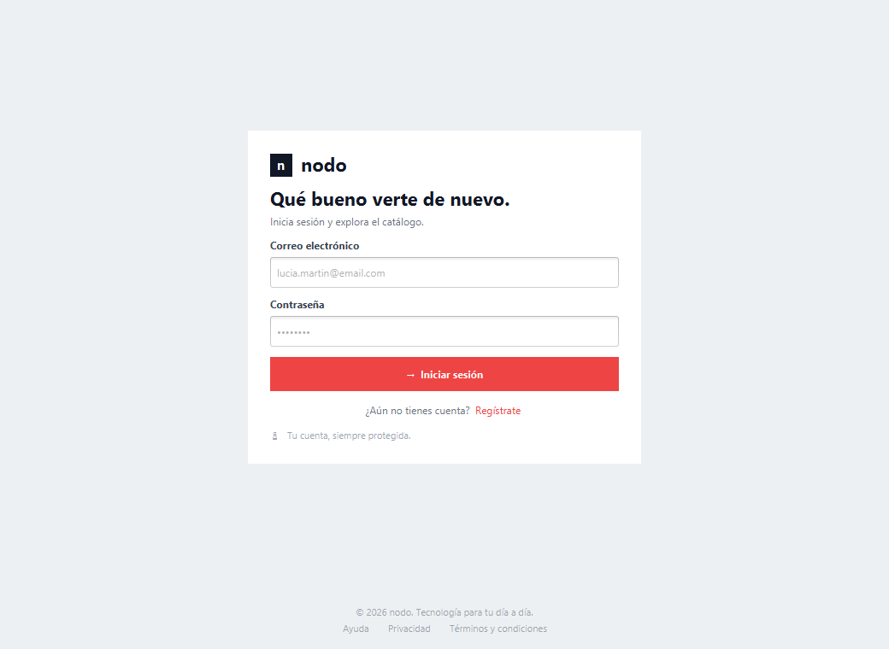

**Pasos:**

1. Abrir la aplicación. Se muestra la pantalla de **Inicio de sesión**.
2. Escribir el **correo electrónico** en el primer campo.
3. Escribir la **contraseña** en el segundo campo.
4. Pulsar el botón **Iniciar sesión**.
5. El sistema valida los datos y abre la pantalla según el rol:
   - Cliente → Catálogo.
   - Administrador → Panel de administración.

**Cuentas de prueba:**

| Perfil | Correo | Contraseña |
|---|---|---|
| Cliente | `lucia.martin@email.com` | `123456` |
| Administrador | `admin@nodo.com` | `admin123` |

Si los datos están vacíos o son incorrectos, aparece un mensaje en rojo: *“Completa el correo y la contraseña”* o *“Usuario o contraseña incorrectos”*.

### 3.2 Registrar una cuenta nueva

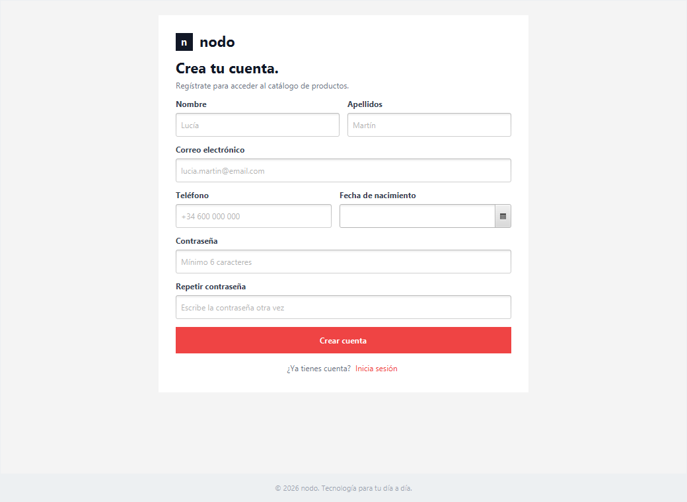

**Pasos:**

1. En la pantalla de login, pulsar el enlace **Regístrate**.
2. Completar: nombre, apellidos, correo, teléfono, fecha de nacimiento, contraseña y repetir contraseña.
3. Pulsar **Crear cuenta**.

**Validaciones automáticas:**

- Todos los campos son obligatorios.
- Nombre y apellidos solo aceptan letras (incluye tildes y ñ).
- El correo debe contener `@` y `.`.
- La contraseña debe tener al menos **6 caracteres**.
- Ambas contraseñas deben coincidir.
- La fecha de nacimiento no puede ser futura.
- No se puede repetir un correo ya registrado.

Al crear la cuenta:

- Se limpian los campos.
- Sale una alerta: **“Cuenta creada”**.
- La cuenta se guarda en `usuarios.txt`, así que sigue existiendo al volver a abrir el programa.

### 3.3 Cerrar sesión

En el catálogo, el detalle o el panel admin, pulsar **Cerrar sesión**. El sistema limpia la sesión y vuelve al login.

---

---

## 4. Cuenta del Cliente

### 4.1 Mi cuenta y contraseña

Desde el catálogo, pulsa **Mi cuenta** para abrir tu sección personal. Ahí puedes ver tu nombre, correo, teléfono y rol, además de actualizar tu contraseña cuando lo necesites.

Para actualizar la contraseña escribe la **contraseña actual**, luego la **nueva** y repítela. Pulsa **Guardar contraseña**: el sistema valida que la actual sea correcta, que la nueva tenga al menos 6 caracteres y que ambas nuevas coincidan. El cambio se guarda en `usuarios.txt` y sirve para el próximo inicio de sesión.

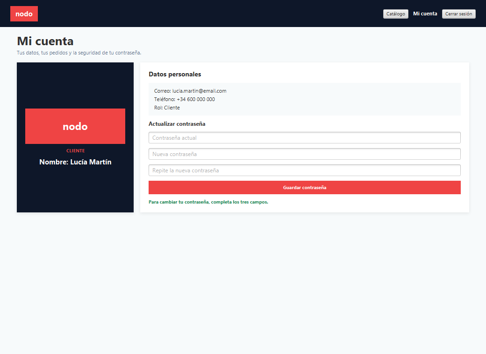

*Sección del cliente con sus datos personales y el formulario para actualizar la contraseña.*

### 4.2 Catálogo de productos

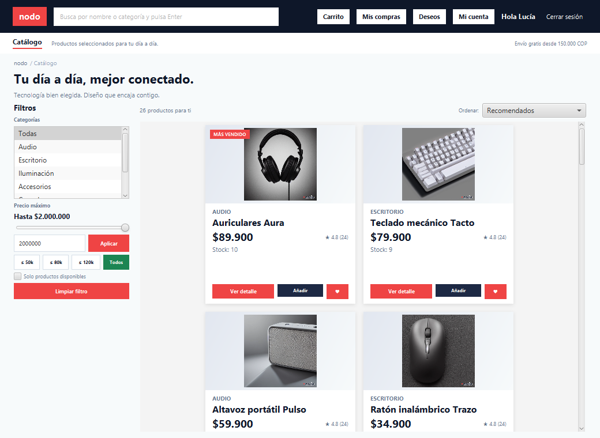

El catálogo muestra **26 productos** organizados en tarjetas. Cada tarjeta contiene foto, categoría, nombre, precio, stock y tres botones: **Ver detalle**, **Agregar** y **Corazón** (favorito).

**Controles disponibles:**

| Control | Para qué sirve |
|---|---|
| Buscador | Filtra por nombre o categoría mientras escribes. |
| Categorías | Muestra Audio, Escritorio, Iluminación, Accesorios, Consolas, Celulares o Electrodomésticos. |
| Precio máximo (slider) | Muestra productos hasta **$2.000.000**. |
| Precio exacto | Permite escribir un valor y pulsar **Aplicar**. |
| Botones ≤ 50k / ≤ 80k / ≤ 120k | Atajos de precio. |
| Botón Todos | Restablece el precio máximo a $2.000.000 para ver los 26 productos. |
| Solo productos disponibles | Oculta los agotados (stock 0). |
| Orden | Recomendados, menor a mayor o mayor a menor precio. |
| Limpiar filtro | Restablece búsqueda, categoría, precio, disponibilidad y orden. |
| Contador | Indica cuántos productos se muestran. |

**Ejemplo:** elegir categoría **Audio**, mover el precio a `$100.000` y escribir “aura”. El catálogo mostrará solo los productos que cumplan las tres condiciones.

### 4.3 Detalle del producto

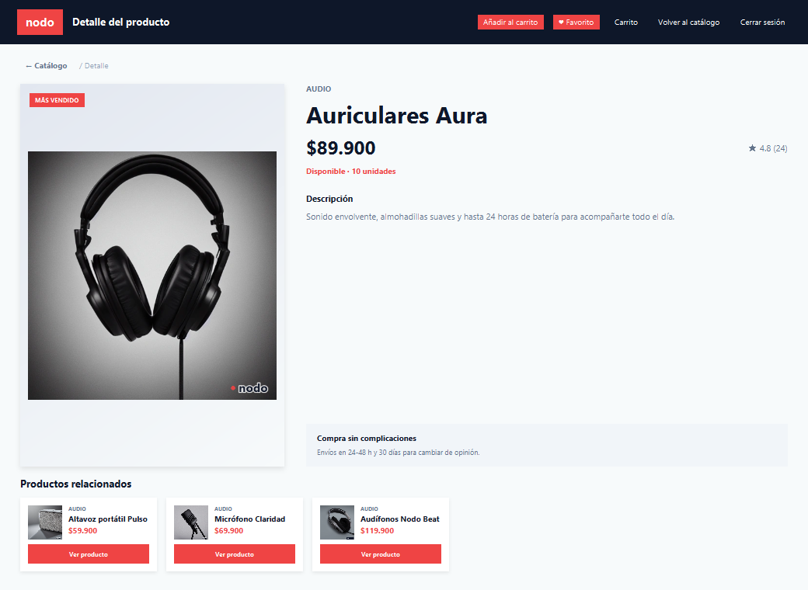

Al pulsar **Ver detalle** en una tarjeta se abre la ficha del producto:

- Imagen del producto.
- Categoría en mayúsculas.
- Nombre y precio.
- Stock disponible o mensaje *“Agotado por el momento”*.
- Descripción.
- Etiqueta **MÁS VENDIDO** si el producto está destacado.
- Productos relacionados de la misma categoría.

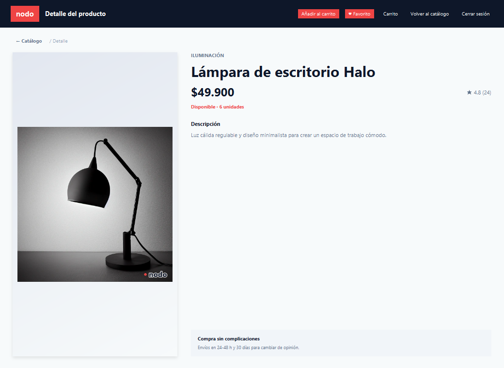

**Productos relacionados:** se muestran hasta 3 productos de la misma categoría, sin incluir el actual. Si no hay ninguno, la sección se oculta.

Las categorías nuevas también tienen su propia imagen con la marca **nodo**:

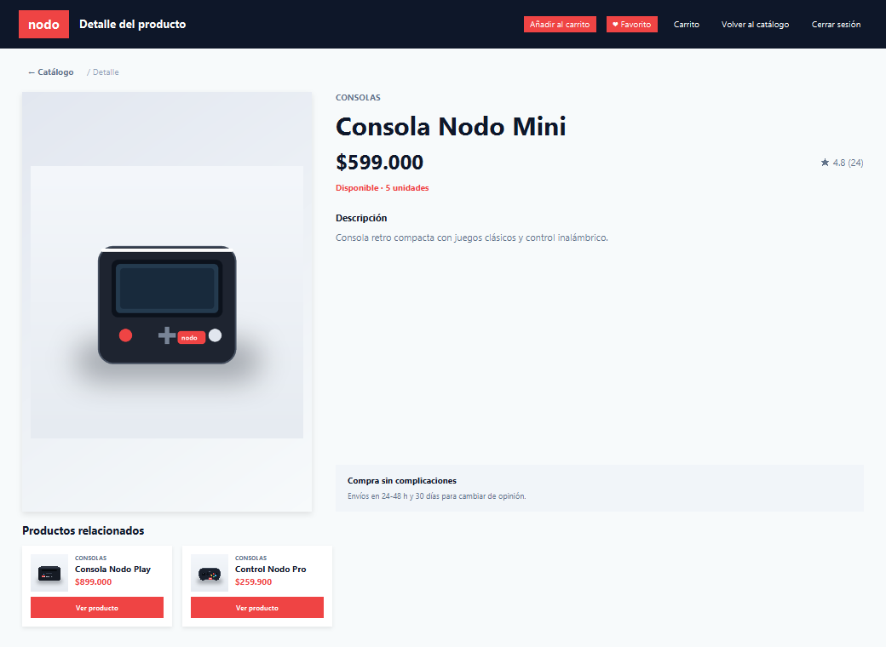

*Consola Nodo Mini: imagen propia, categoría, precio, stock y descripción dentro de la ficha del producto.*

### 4.4 Carrito de compras

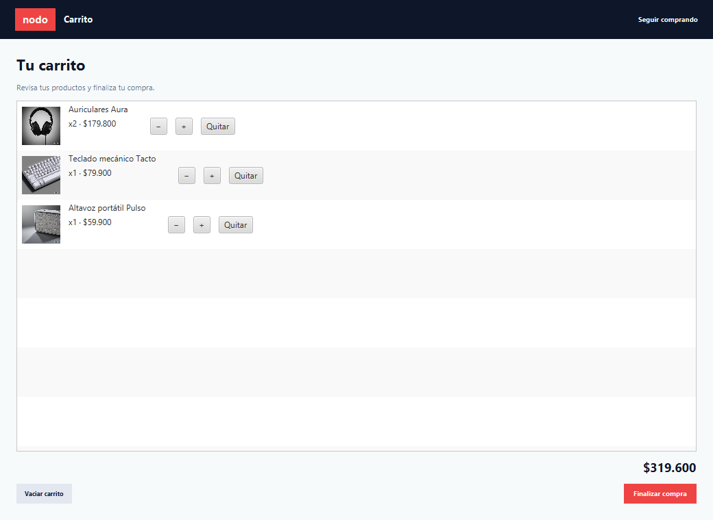

**Cómo agregar productos:**

1. Desde el catálogo, pulsar **Agregar** en la tarjeta.
2. O desde el detalle, pulsar **Agregar al carrito**.
3. Si el producto tiene stock, se guarda en el carrito.

**Dentro del carrito puedes:**

| Acción | Resultado |
|---|---|
| **+ / −** en cada fila | Cambia la cantidad de ese producto sin seleccionarlo. |
| **Quitar** en cada fila | Elimina todas las unidades de ese producto. |
| Vaciar | Pide confirmación antes de borrar todo. |
| Finalizar compra | Guarda la compra y abre el historial. |

El carrito muestra la **foto de cada producto**, el subtotal por producto y el **total general**, con formato de pesos colombianos.

**Alertas:**

- Al vaciar: confirmación *“¿Seguro que quieres quitar todos los productos?”*.
- Al finalizar: *“Compra realizada”*.

### 4.5 Historial de compras

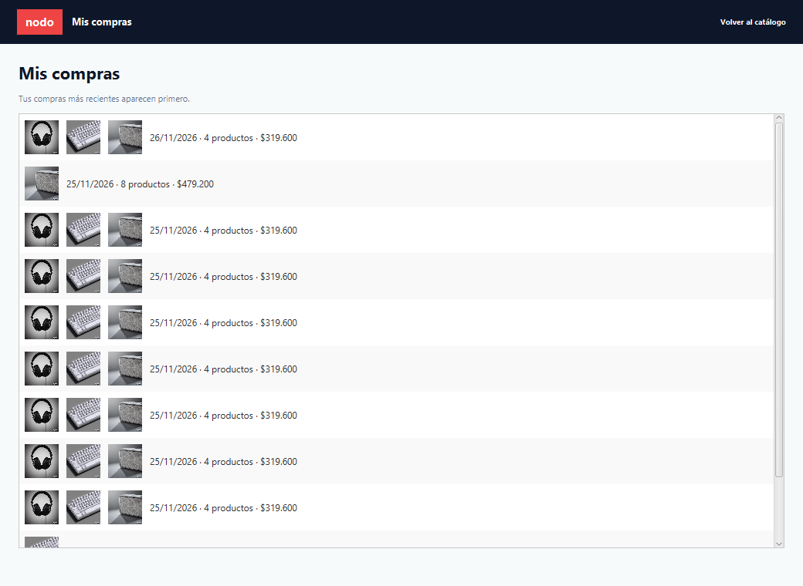

Cada compra finalizada se guarda con las **miniaturas de los productos comprados** y:

- Fecha (día/mes/año).
- Cantidad de productos.
- Total pagado.

La compra **más reciente aparece primero**, porque el historial funciona como pila (LIFO).

### 4.6 Lista de deseos

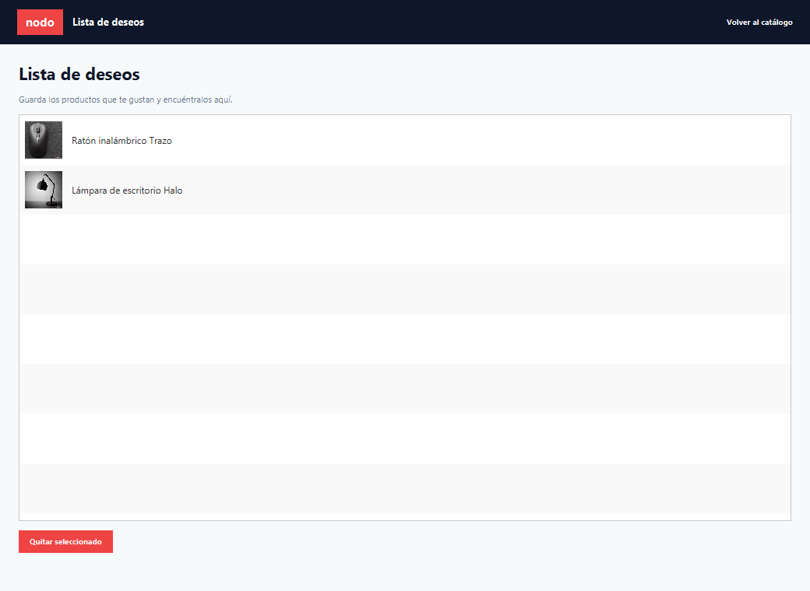

**Para agregar:** pulsar el corazón en una tarjeta o en el detalle.

**Para quitar:** entrar a **Deseos**, seleccionar el producto y pulsar **Quitar**.

Cada favorito se muestra con su **foto**. El sistema evita duplicados: si el producto ya está en la lista, no se agrega otra vez. Si la lista está vacía, se muestra: *“Todavía no tienes productos en tu lista.”*

---

---

## 5. Perfil Administrador

### 5.1 Panel principal

Al entrar como administrador se muestra el resumen:

| Métrica | Qué significa |
|---|---|
| Productos | Cantidad de productos registrados (26 inicialmente). |
| Unidades | Suma del stock de todos los productos. |
| Agotados | Productos con stock 0. |
| Stock bajo | Productos con stock entre 1 y 5. |
| Valor inventario | Suma de precio × stock de todos los productos. |

Además, aparece el **inventario** con ID, nombre, categoría, unidades y precio de cada producto. En el panel puedes ver el resumen y gestionar el producto seleccionado:

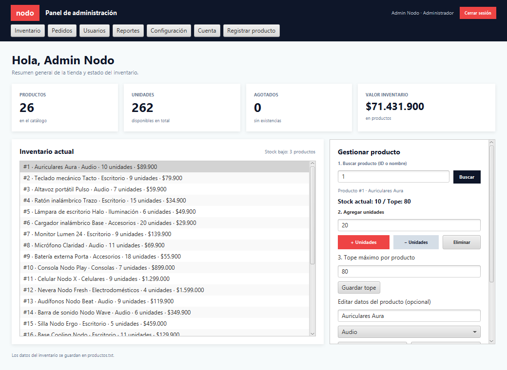

*El inventario muestra el producto seleccionado, el stock actual, el tope máximo y los botones + Unidades, − Unidades y Eliminar.*

> Si un usuario que no es administrador intenta abrir este panel, el sistema lo devuelve al login automáticamente.

### 5.2 Buscar un producto

Puedes seleccionar un producto directamente en la lista **Inventario actual** o buscar por ID o nombre:

1. En el campo **Buscar producto**, escribir el número o parte del nombre (por ejemplo `1` o `Auriculares`).
2. Pulsar **Buscar**.
3. El formulario se llena con los datos del producto y aparece el stock actual.
4. Si no existe, aparece: *“No existe un producto con ese ID o nombre.”*

### 5.3 Editar producto

En el formulario puedes cambiar:

- Nombre.
- Categoría.
- Precio.
- Stock.
- Descripción.

**Validaciones:**

- Nombre, categoría y descripción no pueden estar vacíos.
- Precio y stock deben ser números.
- No se permiten valores negativos.
- El stock no puede superar el tope máximo configurado.

Al pulsar **Guardar cambios**:

- Se actualizan los datos.
- Se recalcula el resumen del inventario.
- Sale la alerta **“Cambios guardados”**.

### 5.4 Agregar unidades al stock

Esta función sirve para aumentar el stock de un producto que ya existe, por ejemplo pasar de 10 a 30 unidades.

**Pasos:**

1. Seleccionar el producto en la lista o buscarlo por ID o nombre.
2. En el campo **Cantidad a sumar**, escribir la cantidad (por defecto aparece `20`).
3. Pulsar **+ Unidades** para sumar o **− Unidades** para restar.
4. Sale la alerta **“Stock actualizado”**.
5. El campo **Stock**, la etiqueta **Stock actual** y el resumen del inventario se actualizan.

El botón **− Unidades** nunca deja el stock por debajo de cero; si pides quitar más de lo que hay, el producto queda en 0.

**Ejemplo:** Auriculares Aura tiene 10 unidades y el tope es 80. Escribes `20` y pulsas **+ Unidades** → queda **30 / 80** y sale una alerta con el resultado. Si pides más del tope, se ajusta al máximo y se avisa. Si el producto ya está en el tope, el sistema lo indica y no modifica el stock.

### 5.5 Registrar producto con imagen

Desde el panel, pulsa **Registrar producto**:

1. Escribe nombre, elige categoría, precio, stock y descripción.
2. Pulsa **Elegir imagen** y selecciona un archivo PNG o JPG.
3. Marca **Producto destacado** si aplica.
4. Pulsa **Registrar producto**.
5. Sale la alerta **“Producto registrado”** y vuelves al panel.

Al elegir imagen, el programa la **copia automáticamente** a `src/main/resources/com/nodo/tienda/vistas/imagenes/`, así que viaja contigo aunque le mandes el trabajo al profesor. Si no eliges imagen, el producto usa la genérica `producto.png`.

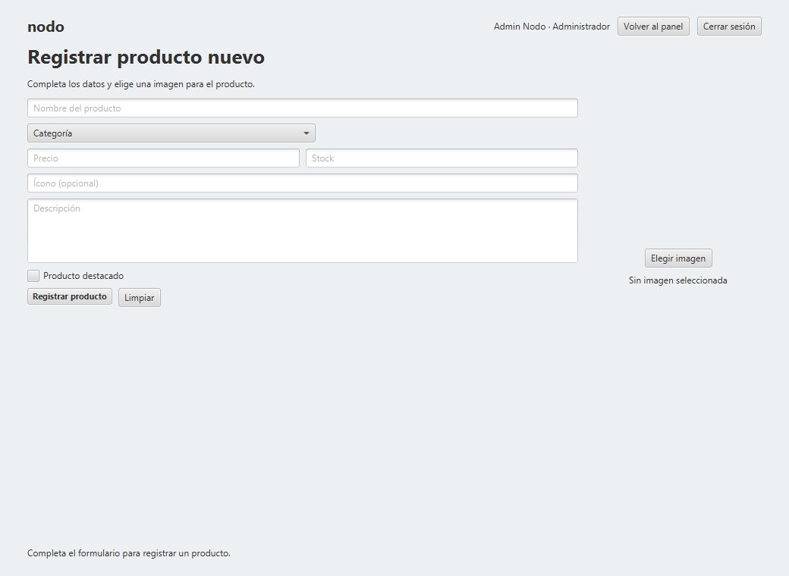

*Aquí se escriben nombre, categoría, precio, stock y descripción, y se elige la imagen del producto.*

### 5.6 Eliminar producto

1. Selecciona el producto en la lista o búscalo por ID o nombre.
2. Pulsa **Eliminar**.
3. Confirma en la alerta.
4. El producto desaparece del inventario y el cambio se guarda.

### 5.7 Secciones del panel

El panel de administración tiene su propia sección, separada del catálogo. En **Inventario** ya vimos el resumen, la búsqueda, la edición, los botones de unidades, el tope, el registro y la eliminación. Las demás secciones funcionan así:

**Pedidos.** Muestra cuántas compras hay, cuántas unidades se vendieron y el total, además de una tabla con fecha, productos, valor y estado de cada pedido.

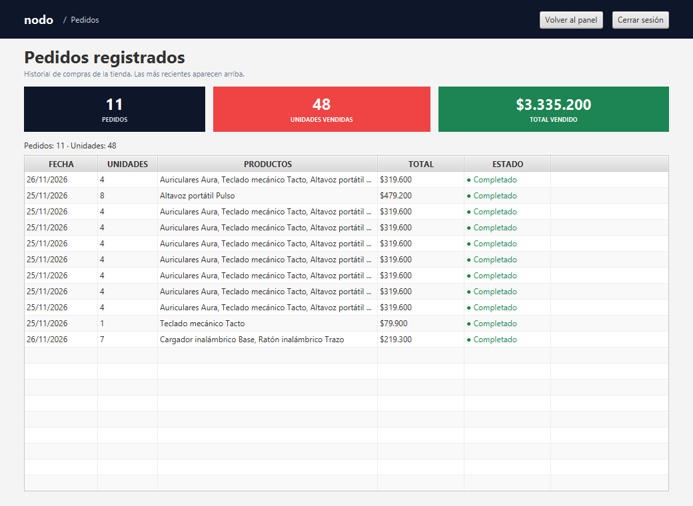

*Cada compra finalizada aparece aquí con estado “Completado”.*

**Usuarios.** Permite buscar por nombre o correo, cambiar el rol y eliminar cuentas. La cuenta principal y la tuya propia están protegidas.

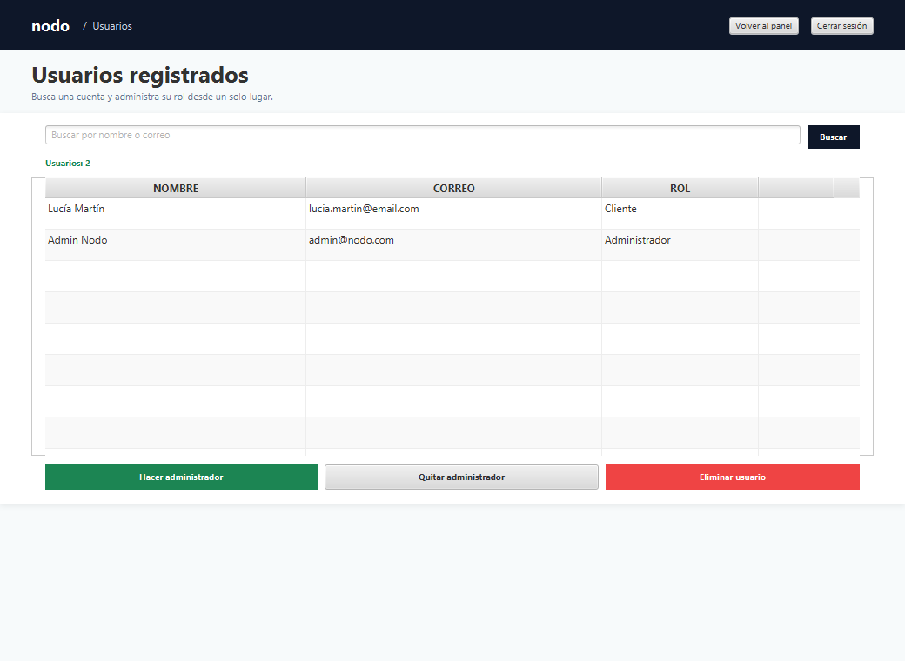

*Tabla de usuarios con búsqueda y controles de rol y eliminación.*

**Reportes.** Reúne las métricas generales y muestra cuántas unidades hay en cada una de las 7 categorías, junto con la salud del inventario.

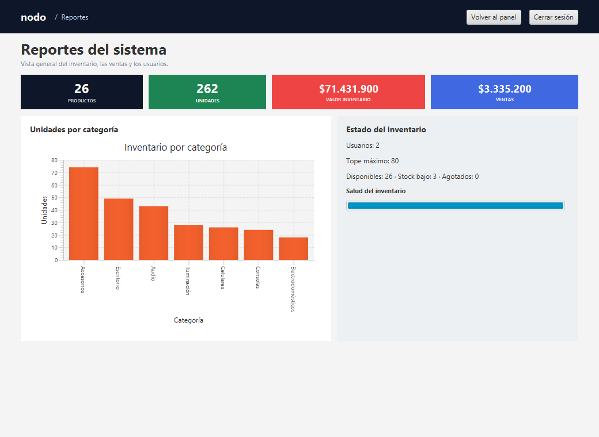

*Barras por categoría, estado del inventario y tope máximo vigente.*

**Configuración.** Aquí el administrador edita su nombre, apellidos, correo, teléfono y contraseña. El correo de la cuenta principal no se puede cambiar.

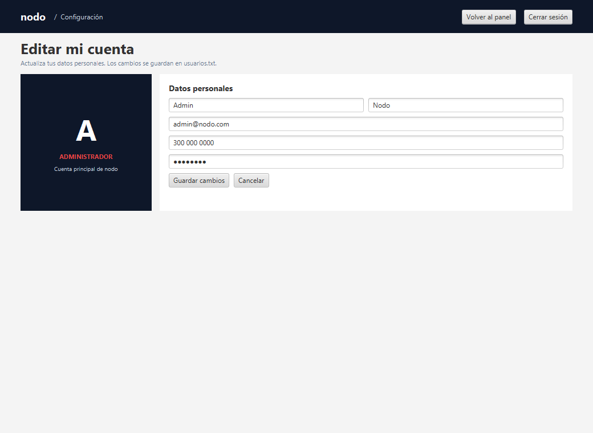

*Formulario de datos del administrador.*

**Cuenta.** Muestra tu perfil, datos personales y rol, con acceso directo a Editar datos.

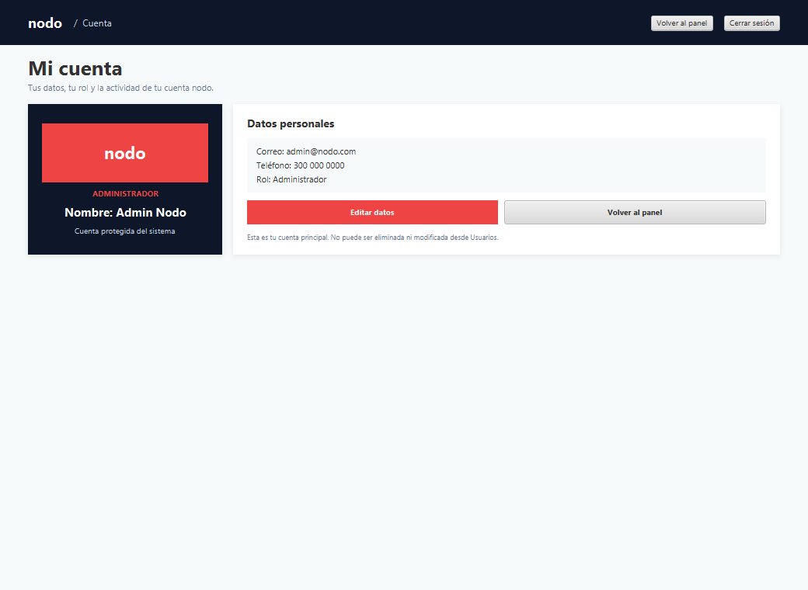

*Tarjeta de perfil nodo y datos de contacto de la cuenta principal.*

### 5.8 Tope máximo por producto

En Inventario, escribe un valor en **Tope máximo** y pulsa **Guardar tope**. El valor debe estar entre **1 y 1000** y, por defecto, es **80**. Ningún producto podrá superar ese número de unidades. Si bajas el tope y hay productos por encima, el sistema **ajusta automáticamente su stock al nuevo tope**, actualiza el formulario y el resumen, y guarda el cambio. El conteo de *stock bajo* es fijo: productos con 1 a 5 unidades.

### 5.9 Cerrar sesión

Pulsa **Cerrar sesión** para volver al login. El admin no necesita entrar al catálogo; todas sus funciones están en su sección.

---

---

## 6. Alertas del sistema

El programa usa ventanas `Alert` de JavaFX (no `JOptionPane`, que pertenece a Swing).

| Situación | Tipo de alerta |
|---|---|
| Vaciar carrito | Confirmación con Aceptar / Cancelar. |
| Compra finalizada | Factura con número, fecha, cliente, productos, cantidades, subtotal, IVA y total. |
| Cuenta creada | Información: “Cuenta creada”. |
| Cambios guardados | Información: “Cambios guardados”. |
| Stock actualizado | Información: “Stock actualizado”. |

Las validaciones de campos se muestran como mensajes en la parte inferior de cada formulario, no como ventanas emergentes.

### 6.1 Prueba visual de las alertas

Estas tres capturas se generaron ejecutando el programa y disparando las acciones reales:

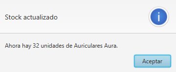

*Al pulsar **+ Unidades**: “Ahora hay 32 unidades de Auriculares Aura.”*

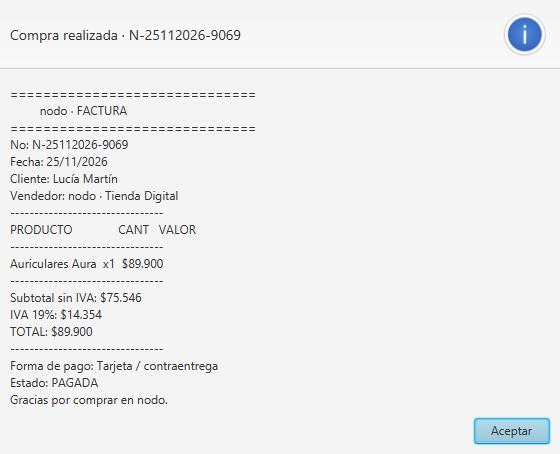

*Al finalizar la compra: factura con número, cliente, productos, cantidades, subtotal, IVA y total.*

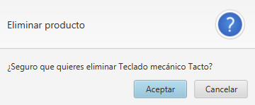

*Al eliminar un producto: confirmación con Aceptar / Cancelar.*

---

---

## 7. Funcionalidades por módulo

| Módulo | Funcionalidades |
|---|---|
| Acceso | Login, registro, validaciones, roles, persistencia de usuarios. |
| Catálogo | 26 productos, búsqueda, 7 categorías, precio hasta $2.000.000, disponibilidad, orden, contador. |
| Detalle | Foto, datos, descripción, stock, etiqueta destacado, relacionados. |
| Carrito | Fotos, cantidades, subtotales, total, quitar, vaciar, finalizar. |
| Historial | Compras con fotos, fecha, cantidad y total, más reciente primero. |
| Deseos | Fotos, agregar, quitar, sin duplicados. |
| Administración | Métricas, inventario, búsqueda por ID o nombre, edición, + unidades, tope máximo, registro con imagen y eliminación. |

---

---

## 8. Preguntas frecuentes

**¿Qué hago si olvidé mi contraseña?**  
Contacta al administrador de la tienda para que restablezca tu cuenta.

**¿Puedo crear productos nuevos?**  
Sí. En el panel, pulsa **Registrar producto**, completa los datos y elige una imagen. El producto recibe un ID automático y aparece en el inventario y en el catálogo.

**¿Los datos se guardan al cerrar la aplicación?**  
Sí. Los productos se guardan en `productos.txt`, los usuarios en `usuarios.txt`, el carrito en `carrito.txt`, el historial en `historial.txt` y los deseos en `deseos.txt`. Al volver a abrir el programa, todo sigue ahí.

**¿Qué pasa si un producto no tiene imagen asignada?**  
Se muestra la imagen genérica `producto.png`.

**¿Cómo agrego un producto al carrito?**  
Pulsa **Agregar** en la tarjeta o **Agregar al carrito** en el detalle.

**¿Cómo veo la compra más reciente?**  
Entra a **Mis compras** desde el catálogo. La última compra aparece arriba.

**¿Se puede ordenar por precio?**  
Sí. En el catálogo, usa el combo **Ordenar**.

---

---

## 9. Glosario

| Término | Significado |
|---|---|
| **Stock** | Cantidad de unidades disponibles de un producto. |
| **SKU / ID** | Número que identifica a un producto. |
| **Carrito** | Lista temporal de productos antes de comprar. |
| **Historial** | Registro de compras ya finalizadas. |
| **Lista de deseos** | Productos guardados como favoritos. |
| **Rol** | Tipo de usuario: Cliente o Administrador. |
| **Alerta** | Ventana emergente que informa o pide confirmación. |
| **Filtro** | Condición para mostrar solo algunos productos. |

---

---

## 10. Control de cambios y sostenibilidad

Si durante la sustentación se actualiza una palabra, un texto, un color o un arreglo visual del manual o de la interfaz, **no se afecta la lógica del sistema** siempre que se respeten:

- Los nombres de los archivos FXML y sus `fx:controller`.
- Los `fx:id` que usan los controladores.
- Los métodos `onAction` conectados a los botones.
- La estructura de los archivos de datos (`usuarios.txt`, `productos.txt`, `carrito.txt`, `historial.txt`, `deseos.txt`).

Un cambio de redacción, de orden visual o de colores es un **ajuste de presentación**. No modifica las estructuras de datos (`ListaEnlazada`, `Cola`, `Pila`, `ListaDeseos`), las validaciones ni la persistencia. Por eso es seguro y válido para sustentar.

## 11. Fin del manual

Con esta guía puedes usar todas las funciones de **Tienda Digital Nodo**. Si la aplicación no abre, verifica que Java 25 y Maven estén instalados y ejecuta `mvn javafx:run`.
